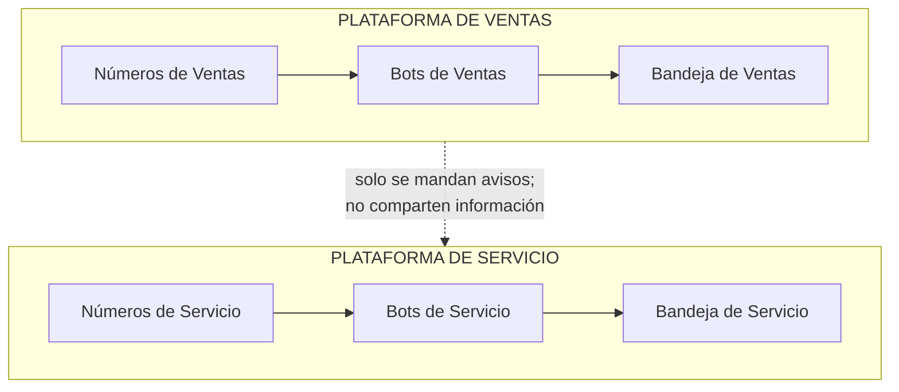
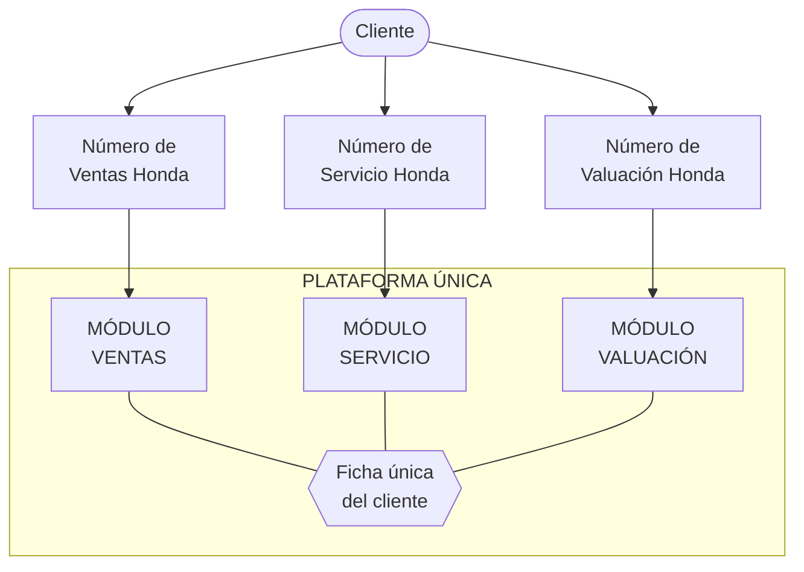
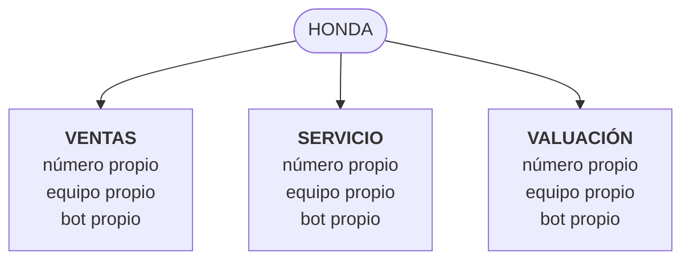
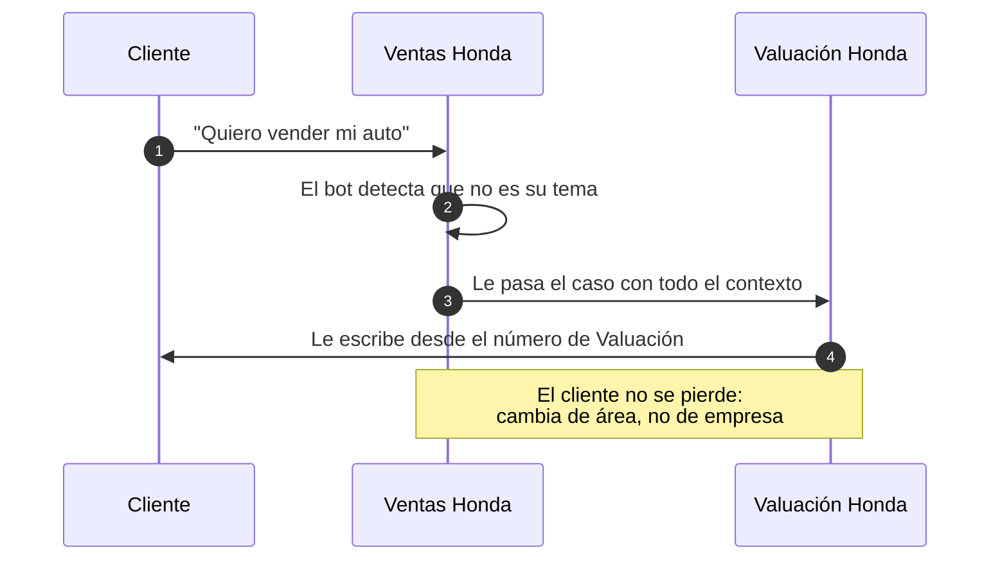
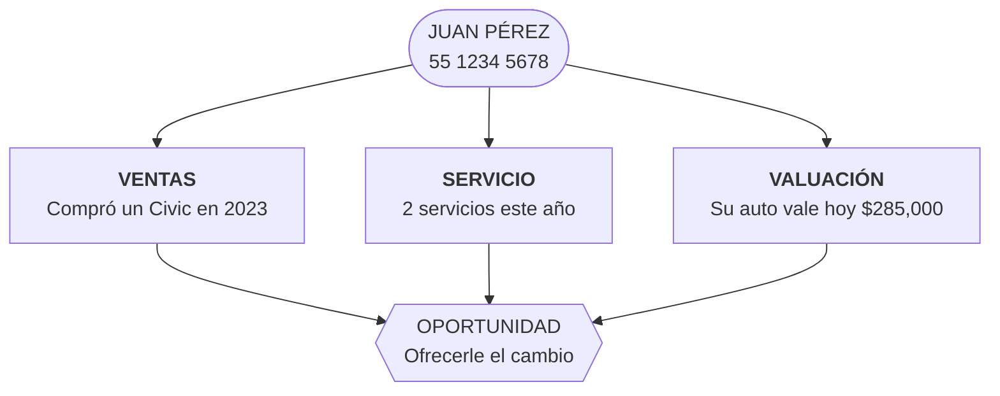
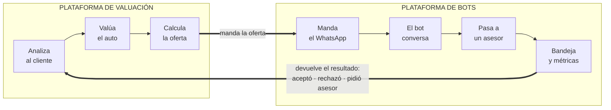

# Una sola plataforma para Ventas, Servicio y Valuación

**Análisis para tomar la decisión · 12 de octubre de 2026**

> Este documento está escrito para quien no conoce la plataforma por dentro.
> El detalle técnico está en [`ANALISIS_CENTRALIZACION_TECNICO.md`](ANALISIS_CENTRALIZACION_TECNICO.md).

---

## 1. El resumen, en una frase

Hoy tenemos **dos plataformas de chatbots casi idénticas** —una de Ventas y una de Servicio— y viene una tercera para **Valuación** (comprar el auto del cliente o tomarlo a cuenta). La propuesta es **juntarlas en una sola plataforma con tres módulos**, donde lo principal es la marca y cada módulo tiene su propio número de WhatsApp.

---

## 2. ¿Qué hace la plataforma hoy? (para quien no la conoce)

Es el sistema que atiende a los clientes por WhatsApp:

- **Recibe y manda mensajes** de WhatsApp a nombre de cada marca.
- **Un bot contesta** las preguntas del cliente automáticamente.
- **Pasa el caso a una persona** cuando el cliente pide un asesor o el bot ya no puede.
- **Respeta horarios de atención** y no promete un asesor fuera de horario.
- **Manda recordatorios** si el cliente deja de responder.
- **Registra todo en Salesforce**: prospectos, citas, resultados.
- **Le da a cada asesor una bandeja** con sus conversaciones, y a la dirección sus métricas.

Todo eso ya funciona en producción, todos los días, para varias marcas.

---

## 3. El problema: hoy son dos plataformas gemelas

Las dos plataformas comparten **prácticamente todo el motor**: la mensajería de WhatsApp, los horarios, los recordatorios, el pase a un asesor, los permisos, el tablero. El tablero de control comparte el **95% de sus pantallas**. Solo se diferencian en las reglas propias de cada negocio.

Eso tiene tres costos que hoy ya estamos pagando:

| Costo | Qué significa en la práctica |
|---|---|
| **Todo se hace dos veces** | Cada mejora, cada arreglo y cada prueba se repite en las dos plataformas. Con Valuación serían tres |
| **Nadie ve al cliente completo** | El mismo cliente está en los dos sistemas y no hay forma de cruzar su historia |
| **Dos bandejas, dos accesos** | Un asesor que toca los dos negocios entra a dos sistemas distintos |

---

## 4. A dónde queremos llegar

Una sola plataforma con tres módulos. El cliente sigue escribiendo al número que le corresponde; por dentro, todo vive en el mismo lugar.

---

## 5. Cómo se organiza: la marca manda

La **marca** es lo principal. Dentro de cada marca viven los tres módulos, y cada uno tiene lo suyo: su número, su equipo de asesores y su bot.

Lo mismo se repite para Nissan, Toyota, Kia y Changan.

**Por qué la marca va primero y no el módulo:** porque los datos del negocio —las credenciales de Salesforce, el código de marca, los catálogos— son de la marca, no del módulo. Si cada módulo fuera su propia cuenta independiente, tendríamos que copiar esa configuración tres veces por marca (quince veces en total), y perderíamos la vista completa del cliente, que es justamente lo que queremos ganar.

---

## 6. Cada módulo con su propio número

Son unos **15 números** en total: 5 marcas × 3 módulos.

**Lo que se gana:**
- El cliente llega al equipo correcto desde el primer mensaje. No hay que adivinar qué quiere.
- Cada número tiene un dueño claro, un equipo responsable y un bot especializado.
- El reporteo sale limpio por marca y por módulo, sin tener que separar nada después.
- **Es la opción más sencilla de construir**: la plataforma ya funciona así por dentro. Cada número ya trae asignados su marca, su equipo y su bot. El módulo prácticamente ya existe, solo falta nombrarlo.

**Lo que cuesta:**
- 15 números que dar de alta, configurar y mantener, cada uno con sus plantillas de mensaje y sus horarios.
- Cada número tiene su propio costo de conversación.

---

## 7. Cuando el cliente toca la puerta equivocada

Va a pasar seguido: alguien le escribe a Ventas y lo que quiere es que le valúen su auto. Hay que resolverlo bien, porque ahí es donde se pierden oportunidades.

**La buena noticia:** este mecanismo ya existe y funciona hoy en producción —es el que usa Ventas para pasar casos a Servicio—. Faltan tres ajustes:

1. **Hoy al transferir se cierra el caso y se marca el prospecto como perdido.** Se diseñó pensando en "esto no es mi negocio, quítamelo de encima". Entre módulos de la misma marca hay que conservar al cliente: cambia de área, no se pierde.
2. **Hoy la transferencia solo sabe mandar el aviso por uno de los tres proveedores de WhatsApp.** Si Valuación queda con otro proveedor, la transferencia no llega. Es un arreglo acotado: el código para los otros dos ya existe en la plataforma de Servicio.
3. **Cada transferencia implica mandarle al cliente un mensaje desde otro número.** Es inevitable con números separados. Es tema de cómo se redacta el mensaje, para que no se sienta como un rebote.

---

## 8. La ficha única del cliente: el verdadero premio

Todo lo anterior —una bandeja, un acceso, un solo código— es **ahorro**. Esto es **negocio nuevo**.

Hoy esa pregunta **no se puede ni formular**, porque la información vive en dos sistemas separados que no se hablan. Y es exactamente el insumo que necesita el módulo de Valuación para hacer su trabajo.

Hay un efecto secundario que hace esto todavía más necesario: con un número por módulo, **el mismo cliente puede tener hasta tres conversaciones abiertas al mismo tiempo**. No se estorban, pero en la bandeja aparecen como tres hilos sin relación. La ficha única es lo que los amarra y le da al asesor la foto completa.

---

## 9. La plataforma de Valuación se conecta, no se reconstruye

Este es probablemente el punto más importante del análisis.

La plataforma de Valuación se queda con **lo que solo ella sabe hacer**: analizar al cliente, valuar el auto, calcular la oferta, manejar el inventario. Y le delega a la plataforma de bots **todo lo que ya está resuelto y probado**: los tres proveedores de WhatsApp, los horarios, los recordatorios, el pase a un asesor, la bandeja, las métricas y la ficha del cliente.

**El riesgo a evitar es construir una tercera copia.** Las dos plataformas actuales ya demuestran lo que cuesta: todo se hace dos veces. Con tres, se hace tres veces, para siempre.

---

## 10. Qué ya está hecho y qué falta

| | Pieza | Estado |
|---|---|---|
| ✅ | Manejo de marcas, equipos, roles y permisos de acceso | Listo |
| ✅ | Los tres proveedores de WhatsApp, más voz y chat web | Listo |
| ✅ | Cada número con su equipo y su bot asignados | Listo |
| ✅ | Horarios de atención, recordatorios, semáforo de espera, etiquetas, campañas | Listo |
| ✅ | Transferir un caso al número de otro módulo | Listo |
| ✅ | Poder conectar un bot hecho por otro equipo | Listo |
| ⚠️ | Una sola puerta de entrada para que otros sistemas disparen conversaciones | Hoy hay cuatro formas distintas, cada una hecha a la medida |
| ⚠️ | Avisarle al sistema de origen cómo terminó el caso | Existe a medias, solo en Servicio |
| ❌ | Transferir entre módulos conservando al cliente | Hoy cierra el caso y lo marca como perdido |
| ❌ | Que la transferencia funcione con los tres proveedores | Hoy solo con uno |
| ❌ | La ficha única del cliente | No existe |
| ❌ | Permisos por marca en la plataforma de Ventas | Ver el punto siguiente |

**Cerca del 70% del destino ya está construido.** Lo que falta son piezas acotadas, no un sistema nuevo.

---

## 11. Lo que hay que cuidar

**1. Seguridad — es lo primero que hay que resolver.**
En la plataforma de Ventas, hoy cualquier persona con acceso puede ver toda la información. Mientras sea un solo negocio, el daño está acotado. Con los tres negocios juntos, un asesor de servicio de una marca podría ver los prospectos de ventas de otra. **La plataforma de Servicio ya tiene esto bien resuelto por marca y por rol**, así que es trasladar lo que ya existe, no inventarlo.

**2. Juntar las dos plataformas: primero el código, después los datos.**
Unificar de golpe es riesgoso: hay que mudar conversaciones en curso, con WhatsApp abierto y clientes esperando respuesta. Conviene unificar primero el código (dos sistemas corriendo igual, por separado) y mudar los datos después, cuando ya no haya diferencias que reconciliar.

**3. Los 15 números tienen un tiempo de alta.**
Dar de alta y aprobar números y plantillas con el proveedor de WhatsApp no es inmediato. Conviene arrancar ese trámite antes que el desarrollo.

**4. Hoy cada plataforma la mantiene un equipo distinto.**
Hay que definir quién es el dueño de la plataforma unificada antes de empezar a juntarlas.

---

## 12. Plan por etapas

Las etapas 1 y 2 **no dependen de las demás**: se pueden entregar primero y le dan valor inmediato al módulo de Valuación, sin esperar a que todo esté unificado.

| Etapa | Qué se hace | Qué se gana |
|---|---|---|
| **0** | Trasladar el esquema de permisos de Servicio a Ventas | Poder juntar los tres negocios sin que nadie vea lo que no le toca |
| **1** | Una sola puerta de entrada para disparar conversaciones | **Valuación puede empezar a operar ya**, sin esperar el resto |
| **2** | Que la plataforma avise cómo terminó cada caso | Valuación cierra su ciclo y puede medir resultados |
| **3** | Unificar las dos plataformas gemelas en un solo código | Cada arreglo y cada mejora se hacen una sola vez |
| **4** | Transferencia entre módulos conservando al cliente | Dejan de perderse oportunidades en el pase de un área a otra |
| **5** | Mudar Servicio a la plataforma unificada | Bandeja única, ficha de cliente, métricas juntas |

---

## 13. Decisiones pendientes

Estas no las resuelve el equipo técnico; hay que definirlas con el negocio:

1. **¿Las ofertas de compra o toma a cuenta se registran en Salesforce**, o el ciclo se cierra dentro de la plataforma de Valuación?
2. **¿Quién pone el "cerebro" del bot de Valuación?** Lo recomendable es que lo ponga la propia plataforma de Valuación —ahí viven el precio, el inventario y las reglas de la oferta—, y que la plataforma de bots solo se encargue de la conversación.
3. **¿Los 15 números ya existen o hay que darlos de alta?** Define cuándo se puede arrancar.
4. **¿Hay una ventana de mantenimiento posible** para la mudanza de datos de la etapa 5?
5. **¿Quién es el dueño de la plataforma unificada?**
