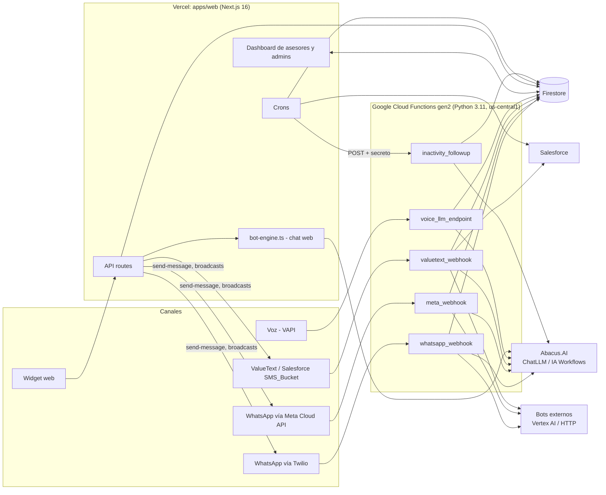
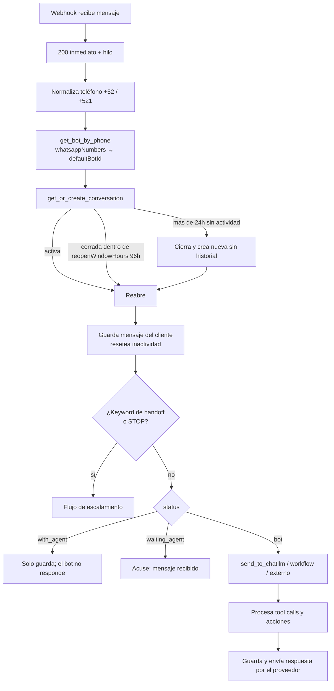
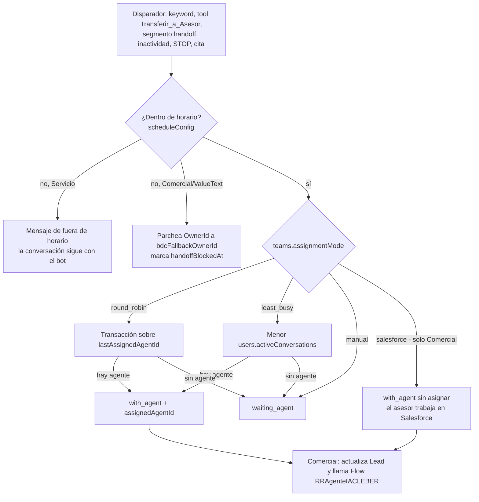
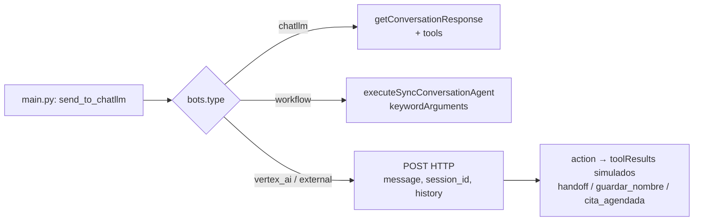
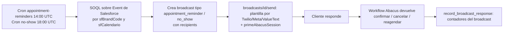
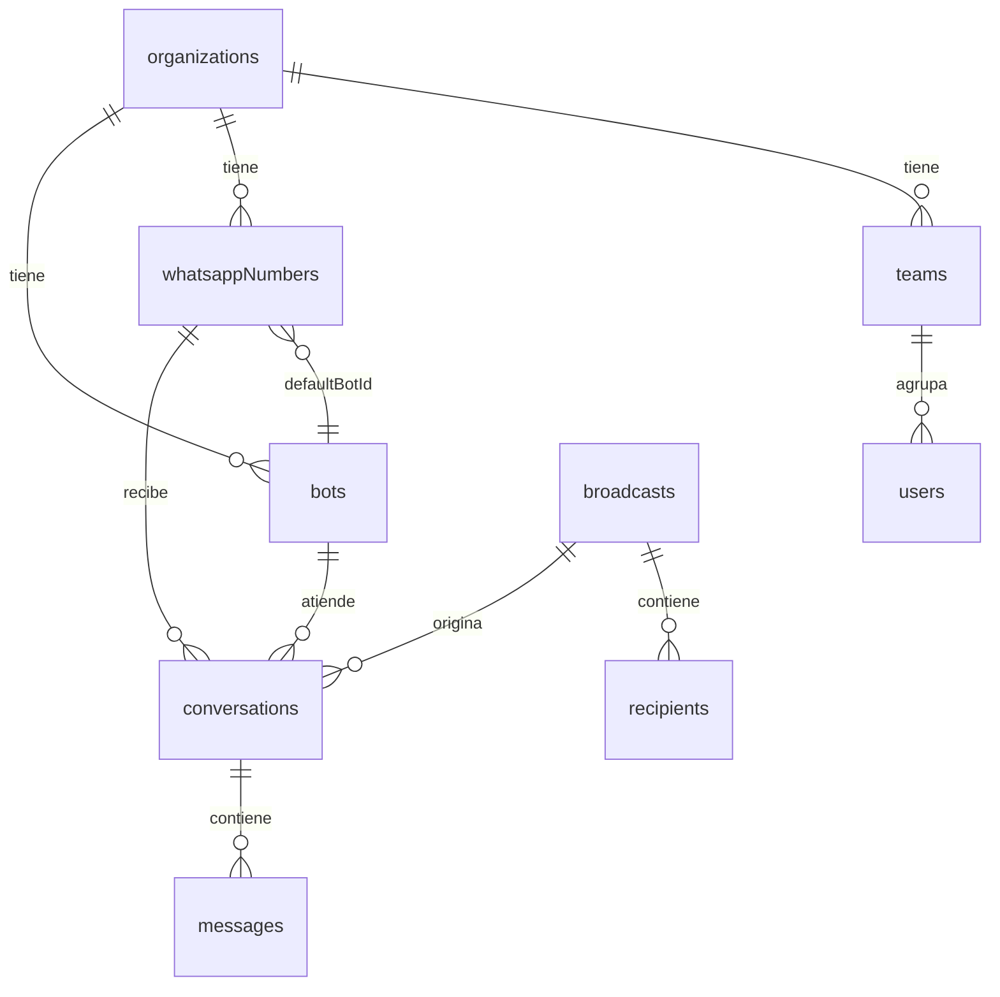

# Análisis de las plataformas actuales: Comercial y Servicio

Fecha: 2026-10-15. Base: lectura del código de ambos repos (no solo de sus docs).

| | **Servicio** | **Comercial** |
|---|---|---|
| Repo | `cleber-bot-platform/HondaChatbotChatLLM` | `cleber-bot-platform-comercial/PlataformaChatbotsComercial` |
| Proyecto GCP | `atomic-hybrid-482121-n7` | `ia-chatbots-ventas` |
| Firestore | base por defecto | base nombrada `chatbots-ventas` |
| `main.py` | 2 654 líneas | 4 738 líneas |
| Host de Abacus | `api.abacus.ai` | `cleber.abacus.ai` (en `main.py`) y `api.abacus.ai` (chat web) |
| Canales | Twilio, Meta, ValueText, voz (VAPI), web | Twilio, Meta, ValueText, voz (VAPI), web |
| Qué lo distingue | Citas de servicio, broadcasts de recordatorio y no-show, asignación round-robin / least-busy en la plataforma | Leads, citas y escalamiento en Salesforce, situaciones (ruteo entre bots) y seminuevos |

Ambos repos nacieron del mismo código: la estructura (`main.py`, `apps/web`, `apps/widget`, Vercel + Cloud Functions + Firestore) es la misma y ha ido divergiendo.

> Lo marcado **(no verificado)** es inferencia que no se confirmó en código o configuración desplegada.

---

## 1. Arquitectura general (común a ambos)



Reglas del diseño actual:

- **No hay Pub/Sub, Cloud Scheduler ni triggers de Firestore.** Todas las Cloud Functions son HTTP. Los "jobs programados" son Vercel Crons que llaman a rutas de Next.js o a la función `inactivity_followup`.
- Los webhooks responden 200 de inmediato y procesan en un `ThreadPoolExecutor`. Por eso se despliegan con `min-instances=1`.
- La web lee y escribe Firestore **directo desde el navegador** (`onSnapshot`); la protección real son las `firestore.rules`.
- **El chat web no pasa por `main.py`.** Usa `lib/bot-engine.ts`, una réplica en TypeScript de `send_to_chatllm`.

---

## 2. La plataforma (apps/web)

Las dos plataformas son un Next.js 16 + React 19 en Vercel, con login de Google (Firebase Auth). Los usuarios viven en `users/{id}` con `role` (`admin|agent|viewer`), `isSuperAdmin`, `organizationIds[]` y `orgTeams{orgId: teamId}`. Sin equipo asignado, el layout bloquea el acceso (salvo superadmin).

### Pantallas (iguales en ambas salvo lo indicado)

| Ruta | Qué hace |
|---|---|
| `/` | Dashboard: métricas en vivo e históricas, tiempo de respuesta |
| `/conversations`, `/conversations/[id]` | Bandeja (lista, kanban, converse), chat del asesor, semáforo, etiquetas, "Marcar cita", paneles de Leads/Accounts/Vehículos de Salesforce |
| `/bots`, `/bots/new`, `/bots/[id]` | Configuración del bot: Abacus, handoff, horarios, inactividad; en Comercial también **Situaciones** |
| `/whatsapp-numbers` | Números por proveedor y canal, equipo, plantillas |
| `/web-channels` | Canales de chat web (`allowedDomains`) |
| `/teams`, `/team` | Equipos, modo de asignación, semáforo, etiquetas, agentes |
| `/broadcasts`, `/templates` | Campañas y plantillas |
| `/settings` | `salesforceConfig` por organización |
| `/organizations` | Solo superadmin (`sfBrandCode`) |

### Rutas API y crons

| | Servicio | Comercial |
|---|---|---|
| `send-message` (asesor envía por Twilio/Meta/ValueText) | Sí | Sí |
| `broadcasts` (+ `send`, `retry`, `check-status`…) | Sí, con `primeAbacusSession` en cada envío | Sí |
| `salesforce/query`, `test-salesforce` | Sí | Sí |
| `invite` (correo vía webhook de Make) | Sí | Sí |
| `abacus-config` (solo lectura de config del deployment) | Sí | Sí |
| `web-chat/*` (públicas, CORS `*`, validan dominio) | Sí | Sí |
| `integrations/situacion-detectada` (**sin auth**, recibe el pase desde Ventas) | **Sí** | No |
| `conversations/assign-agent-by-lead`, `close-by-phone` | No | **Sí** (secreto externo) |
| Cron `close-inactive` | 06:00 UTC, cierra todo con más de 2 h sin mensajes | 00:00 diario |
| Cron `inactivity-followup` | cada 15 min | cada 15 min (ladder de 802 líneas) |
| Cron `appointment-reminders` / `no-show` | 14:00 / 18:00 UTC: consultan `Event` en Salesforce y preparan destinatarios de broadcast | No |
| Cron `scheduled-contact` | No | cada 5 min |
| Cron `verify-lead-templates` | No | cada 5 min |

---

## 3. Cloud Functions

### 3.1 Funciones exportadas

| Función | Servicio | Comercial | Qué hace |
|---|---|---|---|
| `whatsapp_webhook` | Sí | Sí | Twilio: mensajes y status callbacks |
| `meta_webhook` | Sí | Sí | Meta: GET de verificación, POST de mensajes y statuses (solo texto) |
| `valuetext_webhook` | Sí | Sí | Outbound Message SOAP de `rsplus__SMS_Bucket__c`; ACK SOAP, idempotente por Id |
| `voice_llm_endpoint` | Sí | Sí | "Custom LLM" de VAPI; sin horario ni Salesforce |
| `inactivity_followup` | Sí | Sí | Recordatorios y cierre por inactividad (en Comercial también contacto programado) |
| `lead_webhook` | No | **Sí** | Outbound Message del objeto `Lead`: crea o liga la conversación y manda la plantilla |
| `assign_agent_by_lead` | No | Sí, exportada (la doc dice que se migró a Next.js) | Pasa la conversación a `with_agent` por `leadId` |

### 3.2 Pipeline común de un mensaje entrante



### 3.3 Escalamiento a asesor



En Servicio el escalamiento solo afecta a Firestore (no hay Salesforce de por medio). En Comercial, además actualiza el Lead (`Validacion_Prospecto="Llamada urgente"`, Status "Contactado") y dispara el Flow de round-robin de Salesforce con `{leadId, marcaRR}`.

### 3.4 Inactividad y cierre

```mermaid
sequenceDiagram
    participant V as Vercel Cron (cada 15 min)
    participant N as Route inactivity-followup (Next.js)
    participant F as Cloud Function inactivity_followup
    participant A as Abacus
    participant P as Proveedor (Twilio/Meta/ValueText)
    V->>N: dispara
    N->>N: filtra conversaciones status=bot sin respuesta del cliente
    N->>F: POST con X-Cron-Secret
    F->>A: __ADMIN_FOLLOWUP_n__ (o plantilla si useTemplate)
    A-->>F: texto del recordatorio
    F->>P: envía
    F->>F: sube inactivityRemindersSent; si es el último, cierra
```

Diferencias: en Comercial el ladder soporta plantillas ValueText, escalamiento a asesor tras el último recordatorio (`escalateToAdvisor`: Flow RR o PATCH de `OwnerId`), ventana de envío (`sendingHours`) y, si no hubo cita, actualiza el Lead (`_reset_lead_sin_respuesta` o "Finalizado sin cita"). En Servicio solo recuerda y cierra con `conversationOutcome=inactividad`.

---

## 4. Abacus

### 4.1 ChatLLM

Es el motor de la mayoría de los bots (Honda Ventas y Nissan en el repo de Servicio; Honda, Nissan, Changan y seminuevos en Comercial).

- Llamada: `POST /api/v0/getConversationResponse` con `deploymentToken`, `deploymentId`, `message`, `executeUsercodeTools: true` y `externalSessionId = id de la conversación en Firestore`.
- **Solo viaja el último mensaje del cliente.** El historial vive en la sesión de Abacus, identificada por `externalSessionId`.
- Timeout de 120 s, sin reintentos. Sin SDK (HTTP directo).
- Los **prompts (`behavior_instructions`) viven en Abacus**, no en el repo. Se editan con el SDK de Python y `retrain_model`. El dashboard solo lee la configuración (`abacus-config`).
- Las **tools se definen en Abacus**. El repo solo lee `toolResults`/`segments` de la respuesta y ejecuta la acción real.
- Códigos de control que `main.py` envía y que cada bot debe entender: `__ADMIN_FOLLOW_INSTRUCTIONS_MESSAGE_OUTPUT__` (fuera de horario), `__ADMIN_FOLLOWUP_n_RECORDATORIO__`, `__ADMIN_FOLLOWUP__` y `__ADMIN_FOLLOWUP_CIERRE__`.
- Contexto: Comercial antepone `<<CONTEXTO>>` (lead, fuera de horario, cambio de bot) y `<<PLANTILLA>>` al mensaje. En Servicio, el contexto de campaña se inserta en el historial local pero **no se envía a Abacus**; solo llega por `primeAbacusSession` al enviar el broadcast.

### 4.2 Tools por plataforma

| Plataforma | Tool | Qué dispara en el repo |
|---|---|---|
| Ambas | `Transferir_a_Asesor(motivo)` | Handoff |
| Ambas | `Guardar_Nombre_Cliente(nombre)` | `customerName` |
| Servicio | `Registrar_Cita` | `appointmentStatus=cita_bot`, outcome |
| Servicio | `Clasificar_Motivo` (`interes_cita` / `otro_motivo`) | `conversationOutcome`, `aiOutcome` (confirmado solo en workflows de Servicio) |
| Comercial | `Crear_Lead(nombre, apellido)` | Lead en Salesforce (con claim anti-concurrencia de 120 s) |
| Comercial | `Actualizar_Lead(...)` | Enriquece el Lead |
| Comercial | `Crear_Cita_Ventas_Salesforce(hora, fecha, concesionaria, familia_modelo)` | PATCH o POST del `Event` |
| Comercial | `Detectar_Situacion(situacion, motivo)` | Ruteo por `situationRouting[]` |
| Comercial | `Agendar_Recordatorio`, `Cancelar_Recordatorio` | Contacto programado |
| Comercial | `Get_Family_Ids_Salesforce`, `Obtener_fecha_hora_actual` | Se ejecutan dentro de Abacus (webhook de Make) |
| Seminuevos | `seminuevos_get_catalogo`, `_asistente_financiero`, `_get_detalles_vehiculo`, `info_cleber` | Lectura, se ejecutan en Abacus contra la API de Cleber |
| Seminuevos | `seminuevos_registrar_lead`, `_agendar_cita_sf`, `_actualizar_lead` | Legacy, a retirar (ver `PLAN_UNIFICACION_TOOLS_SEMINUEVOS.md`) |

Las tools de escritura del comercial son **"eco"**: solo devuelven sus parámetros; la acción real la ejecuta `main.py` al detectar la llamada. Esa detección depende del formato interno de Abacus (`segments`, texto "Executing X") y ya falló una vez (18-sep-2026, se perdieron los parámetros).

### 4.3 IA Workflows

| | Servicio | Comercial |
|---|---|---|
| ¿Se usan? | **Sí**: Citas Nissan y Kia Servicio (tipo `workflow`) | **Soporte en código**, pero no hay ninguno verificable; los bots son ChatLLM con custom tools |
| Invocación | `GET getApiEndpoint` (cachea `proxyEndpoint`) y `POST {proxy}/api/executeSyncConversationAgent` | Igual |
| Entrada | `keywordArguments{<workflowInputName>: texto, telefono_cliente}` + `externalSessionId`; header `APIKEY` | Igual |
| Salida | Segmentos `id="action"`: `handoff`, `pre_registro`, `cita_agendada`, `interes_cita`/`otro_motivo`, `confirmar_cita`/`cancelar_cita`/`reagendar_cita` | Se parsea con `check_appointment_action` / `check_handoff_tool_call` |
| Código fuente | **No está en HCB**: vive en `function-source/` (`workflow_citas_servicio_updated.py`, `workflow_kia_servicio.py`, etc.) | `workflow_kia_servicio.py` aparece en el CLAUDE.md pero no existe en el repo |

El workflow de Citas Nissan usa `CLAUDE_SONNET_4`, lista de talleres hardcodeada y el API de citas de Cleber (`ServiceAppointments.getAvailableSlots`, `newAppointment`, `getAppointment`, `deleteAppointment`).

Honda Ventas (que también se aloja en este repo) es ChatLLM puro, sin workflows. Toyota va por Vertex AI (`gcp-toyota-bot/`, no revisado a fondo).

### 4.4 Tipos de bot (`bots.type`)



---

## 5. Lo exclusivo de Comercial

### 5.1 Ciclo de vida de un Lead

```mermaid
sequenceDiagram
    participant SF as Salesforce
    participant LW as lead_webhook
    participant FS as Firestore
    participant AB as Abacus
    participant VT as ValueText (SMS_Bucket)
    participant C as verify-lead-templates (cron 5 min)
    SF->>LW: Outbound Message de Lead nuevo
    LW->>LW: dedup (lead_processed_ids), normaliza teléfono
    LW->>FS: GCL_Marca__c → organizations.sfBrandCode → whatsappNumbers
    alt ya hay conversación abierta
        LW->>FS: sin leadId: liga; con otro leadId: marca el nuevo como Duplicado
    else no hay
        LW->>FS: crea conversación con leadId
    end
    LW->>AB: primea sesión con <<CONTEXTO>> y <<PLANTILLA>>
    LW->>VT: inserta plantilla (SMS_Bucket__c)
    C->>SF: consulta status real de la plantilla
    C->>FS: si FAIL, pasa a with_agent (templateFailed)
```

### 5.2 Situaciones (ruteo entre bots)

`Detectar_Situacion` activa `process_situacion_handoff` con `bots.situationRouting[]`. Aplica en los tres canales de mensajería.

| Destino | Qué hace |
|---|---|
| `cambiar_bot` | Cambia el bot activo de la conversación (`activeBotId`) y lo arranca con `<<CONTEXTO>>` |
| `interno` | Crea una conversación en otro número de la plataforma |
| `externo` | POST a `externalUrl`; así llega a Servicio vía `integrations/situacion-detectada` |
| `lead` | Solo seminuevos: crea un Lead con `SEMINUEVO_RECORD_TYPE_ID` y el owner de la ruta, o llama al Flow RR si ya hay lead |
| `ninguno` | No hace nada |

### 5.3 Cita

`create_salesforce_appointment` hace PATCH del `Event` existente (por `Subject LIKE 'Cita presencial%'`) o POST si no hay; nunca borra. Sin fecha u hora parseable responde `CITA_INPUT_INVALIDO_MESSAGE`. `_handle_cita_rr` llama al Flow RR en horario y, fuera de horario, hace PATCH al `bdcFallbackOwnerId`. Marca `appointmentStatus="cita_bot"` en Firestore.

### 5.4 Opt-out (STOP)

Solo en ValueText: `_is_stop_message` escala la conversación y marca el Lead como "Finalizado por cliente".

---

## 6. Lo exclusivo de Servicio

### 6.1 Recordatorios de cita y no-show



Los crons solo preparan destinatarios; que el envío sea automático **(no verificado)**.

### 6.2 Pase de Ventas a Servicio

`integrations/situacion-detectada` (sin auth, por contrato) recibe el pase desde el bot de Ventas, envía una plantilla al `targetPhone`, crea o reutiliza la conversación y primea el bot de Servicio. Ver `INVENTARIO_FUNCIONES_CLASIFICADAS.md` para el inventario completo.

### 6.3 Outcomes

Servicio registra `conversationOutcome` (`cita_bot`, `cita_agente_bdc`, `inactividad`, etc.) y su historial; Comercial usa `appointmentStatus` y `completedLead`.

---

## 7. Modelo de datos Firestore

Colecciones compartidas: `organizations`, `bots`, `whatsappNumbers`, `teams`, `users`, `conversations` (+ `messages`, y `notes` en Servicio), `labels`, `templates`, `webChannels`, `broadcasts` (+ `recipients`) y las de dedup (`valuetext_processed_ids`, y `lead_processed_ids` en Comercial).



| Colección | Campos clave |
|---|---|
| `organizations` | `sfBrandCode` (enruta leads), `salesforceConfig{instanceUrl, clientId, clientSecret, username, password}`; Comercial añade `ownerId`, `bdcFallbackOwnerId`, `marcaRR`, `vehicleType`, `leadCreationEnabled`; Servicio añade `sfCalendario` |
| `bots` | `type`, `abacusConfig{deploymentId, deploymentToken, apiKey, workflowInputName}`, `handoffConfig`, `scheduleConfig` (un solo bloque por día), `inactivityConfig`, `reopenWindowHours`; Comercial añade `situationRouting[]`, `externalConfig` |
| `whatsappNumbers` | `provider`, `phoneNumber`, `channel`, `defaultBotId`, `teamId`, credenciales por proveedor, plantillas (`leadTemplateId`, `followup*TemplateId`, `serviceHandoff*`) |
| `teams` | `assignmentMode` (`manual`, `round_robin`, `least_busy`; Comercial también `salesforce`), `lastAssignedAgentId`, `semaphoreThresholds` |
| `conversations` | `status` (`bot`, `waiting_agent`, `with_agent`, `closed`), `channel`, `customerPhone`, `leadId`, `assignedAgentId`, `lastCustomerMessageAt`, `inactivityRemindersSent`, `appointmentStatus`, `closedReason`, `broadcastContext`, `activeBotId` |

Configuración por marca: una organización = una marca. En Comercial, `marcaRR` es lo que se manda al Flow de round-robin.

### Variables de entorno (solo nombres)

- Funciones: `MAX_HISTORY_MESSAGES`, `SESSION_TIMEOUT_HOURS`, `CRON_SECRET`. **Credenciales de Salesforce, Twilio, Meta y Abacus no están en variables: están en Firestore, en texto plano.**
- Web: `NEXT_PUBLIC_FIREBASE_*`, `FIREBASE_SERVICE_ACCOUNT_KEY`, `ABACUS_API_KEY`, `CRON_SECRET`, `INACTIVITY_FUNCTION_URL`, `EXTERNAL_API_SECRET` (Comercial), `TWILIO_STATUS_CALLBACK_URL` y `NEXT_PUBLIC_APP_URL` (Servicio).

---

## 8. Riesgos y deuda técnica (resumen)

**Seguridad (los más urgentes)**

1. **Secretos en repos y Firestore.** La API key de Abacus está en claro en los `CLAUDE.md` de ambos repos; hay un deployment token en el `.env.example` de Servicio, una service account JSON en `function-source/` y una key del API de citas en el código del workflow. Contraseñas y tokens de Salesforce/Twilio/Meta están en texto plano en Firestore.
2. **Reglas de Firestore.** Comercial permite leer y escribir todo a cualquier usuario autenticado, por lo que cualquier sesión puede leer `clientSecret` y tokens. Servicio tiene reglas por organización y rol, aunque `bots` y `whatsappNumbers` son legibles por cualquier miembro de la org **(inferido de las reglas)**.
3. **Webhooks sin verificación de origen.** No se vio validación de firma de Twilio ni de Meta, ni token en los webhooks SOAP de Salesforce, y varios se despliegan con `--allow-unauthenticated`. `inactivity_followup` solo valida `CRON_SECRET` si la variable está definida.
4. Las rutas con Admin SDK validan identidad, no pertenencia a la organización.

**Funcionamiento**

5. **Pipeline triplicado** en `_process_twilio_message`, `_process_valuetext_message` y `_process_meta_message` (más voz). Ya divergen: Twilio y Meta de Comercial no crean Lead ni bloquean fuera de horario; voz no revisa horario.
6. **Trabajo después del 200 en un hilo**: puede perderse si la instancia recorta CPU. Se mitiga con `min-instances=1`.
7. **Caches en memoria por instancia** (`_bot_cache`, `_salesforce_tokens`, `_abacus_proxy_cache`, dedup de voz). Algunos crecen sin límite.
8. **Sin idempotencia en Twilio y Meta**: solo ValueText deduplica. Los reintentos pueden duplicar respuestas. Dos mensajes simultáneos pueden crear dos conversaciones (la búsqueda y la creación no son transaccionales).
9. **Detección de tools frágil**: depende del formato interno de Abacus y de frases en español para el handoff.
10. **Inactividad incoherente (Servicio)**: `SESSION_TIMEOUT_HOURS=24` ignora `reopenWindowHours`; `inactivityCloseHours` no lo lee nadie; `close-inactive` usa 2 h fijas y cierra incluso conversaciones `with_agent`.
11. **Fallos de Salesforce solo van al log**: sin reintentos ni cola.
12. **Entradas no soportadas**: Meta y ValueText ignoran mensajes que no sean texto; Twilio ignora `MediaUrl` entrante.
13. **Dos hosts de Abacus** en Comercial (`cleber.abacus.ai` y `api.abacus.ai`) y un motor web distinto del de las funciones.
14. **Constantes hardcodeadas** (owners y RecordType de seminuevos, versiones de la API de Salesforce v59/v60/v66).
15. **Documentación desfasada.** Comercial: el CLAUDE.md dice que el handoff siempre va a `waiting_agent`, pero el código soporta `salesforce` y round-robin. Servicio: el CLAUDE.md dice que el widget no está en `public/`, pero sí está. Prompts y workflows de Servicio viven en `function-source/` (copia de otro desarrollador).

**Qué implica para la unificación**

- La unificación debe elegir una sola implementación del pipeline de mensajes (el hub ya la porta a `channels/` y `modules/`).
- Hay que decidir dónde viven los prompts y workflows: hoy están solo en Abacus y en `function-source/`.
- Los modos de asignación, la lógica de horario y el opt-out difieren entre plataformas; ya se resolvieron varios en `DECISIONES_UNIFICACION.md`.
