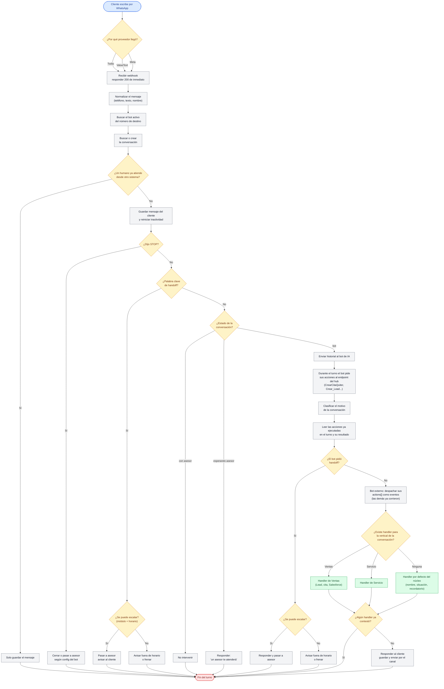
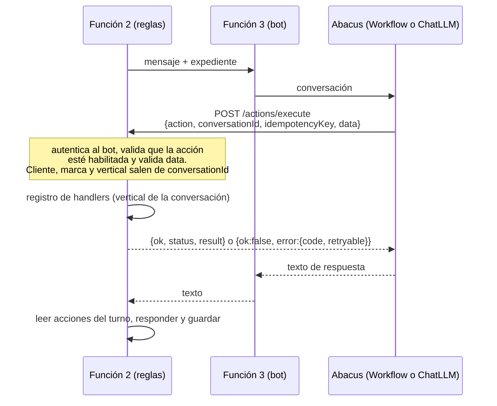
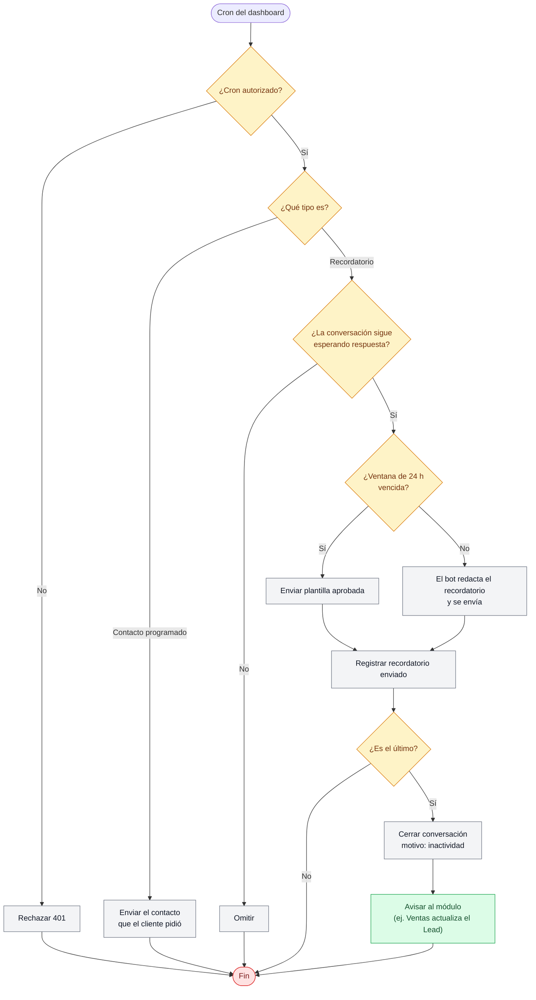

# Flujo centralizado de mensajes

Un solo flujo para los tres proveedores. El proveedor solo define cómo llega el mensaje y cómo se contesta; las reglas de negocio viven en módulos (Ventas, Servicio) que se enchufan al núcleo.

## Flujo de un mensaje entrante

**Leyenda:** azul = inicio, amarillo = decisión, gris = acción del núcleo, verde = lógica de negocio por módulo, rojo = fin.

## Qué decide el módulo y qué decide el núcleo

| Lo hace el núcleo (igual para todos) | Lo hace el módulo (según la vertical) |
|---|---|
| Recibir, normalizar y guardar el mensaje | Crear o actualizar el Lead en Salesforce |
| Detectar STOP, handoff y estado | Agendar la cita de ventas |
| Hablar con el bot de IA | Qué hacer al escalar o al cerrar por inactividad |
| Detectar qué tool pidió el bot | Reglas propias de cada área |
| Responder y guardar la respuesta | |

## Flujo aparte: el bot pide una acción

Desde el 16 de octubre de 2026 los bots de Abacus ya no devuelven acciones para que el hub las detecte: las piden por HTTP y reciben el resultado (§7.8 del plan).

- **Workflow:** un paso HTTP. Ramifica según `error.code` y `retryable`.
- **ChatLLM:** un tool personalizado que hace el mismo POST. Falta confirmar que Abacus lo permite (tarea 1.47); si no, sigue la detección posterior.
- **Bot externo:** conserva `actions: [...]` en su respuesta; el pipeline las despacha.
- **Handoff:** el gate de horario y módulo se aplica dentro del endpoint; el bot recibe "escalado" o "fuera de horario".
- **Ojo:** la función 2 espera a la 3 mientras Abacus llama de vuelta a la 2 (reentrada, tarea 1.45).

## Flujo aparte: recordatorio por inactividad

