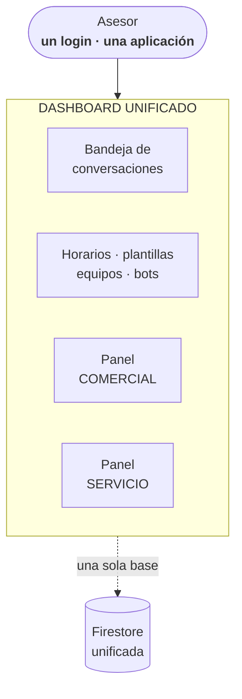
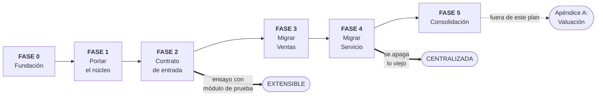
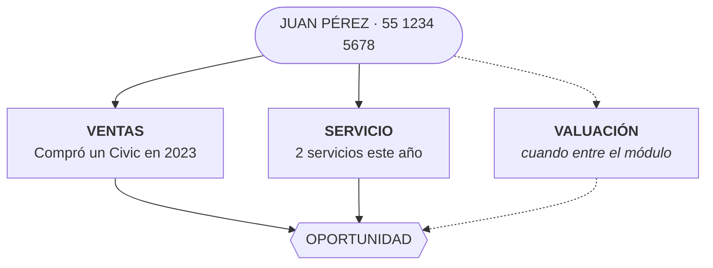
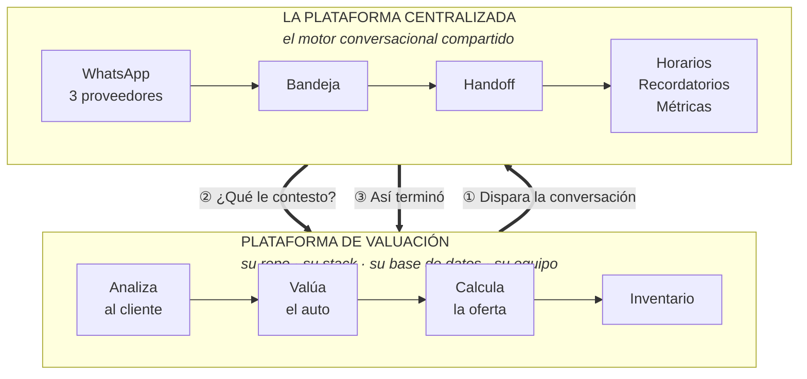

# Plan de trabajo — Centralización de plataformas

**Fecha: 14 de octubre de 2026**
**Premisa: arranque desde cero** — repo nuevo, proyecto de Google Cloud nuevo, proyecto de Vercel nuevo.
**Alcance: centralizar Comercial + Servicio. Valuación queda fuera** (ver Apéndice A).

Plan de ejecución derivado de:
- [`ANALISIS_CENTRALIZACION_PLATAFORMAS.md`](ANALISIS_CENTRALIZACION_PLATAFORMAS.md) — la decisión, en lenguaje de negocio
- [`ANALISIS_CENTRALIZACION_TECNICO.md`](ANALISIS_CENTRALIZACION_TECNICO.md) — el detalle técnico y los hallazgos medidos

Documentos hermanos:
- [`INVENTARIO_FUNCIONES_CLASIFICADAS.md`](INVENTARIO_FUNCIONES_CLASIFICADAS.md) — las 59 funciones exclusivas, con su destino
- [`TAREAS_PENDIENTES.md`](TAREAS_PENDIENTES.md) — el checklist de trabajo por fase

---

## 1. El destino y el alcance de ahora

**El destino:** una sola plataforma, organizada por **marca**, con los módulos de **Comercial y Servicio** conviviendo en un solo repo, una sola base y una sola bandeja — **una aplicación con un solo login**, un solo código y una **ficha única de cliente** que cruza los dos módulos.

Diseñada para que un módulo más entre sin abrir el núcleo, pero **ese módulo no se construye aquí**.

**El alcance de este plan: Comercial + Servicio. Nada más.**

| | |
|---|---|
| ✅ **Dentro** | Centralizar Comercial y Servicio en una sola plataforma: un repo, una base, una bandeja, un login, un solo código |
| ❌ **Fuera** | El módulo de Valuación, completo. Sus números, su bot, su contrato de salida y sus pantallas → **Apéndice A**, para cuando el negocio lo defina |

### Qué cambia por dejar Valuación de lado

**Mucho menos de lo que parecería: las fases 0 a 5 quedan prácticamente iguales.** La razón está medida en §3 — de los ocho ganchos de extensibilidad que el plan contemplaba, **siete se justifican por la centralización misma**, no por Valuación:

| Gancho | Por qué lo necesita la centralización, sin Valuación |
|---|---|
| `vertical` en `teams` y `conversations` | Es lo que separa Comercial de Servicio dentro de una base compartida |
| `customers` + `customerId` | Es la ficha única de cliente **entre Comercial y Servicio** |
| `source` / `externalId` | Trazabilidad de qué sistema disparó cada conversación |
| `sfBrandCode` único | Con dos verticales en una base ya hay colisión silenciosa posible |
| Estrategias de parseo por motor | Comercial corre ChatLLM y Servicio corre Workflows: hacen falta las dos |
| Contrato de entrada único | Colapsa los **4 caminos ad-hoc** que existen hoy |
| Shell con vistas por módulo | Es la forma del dashboard unificado con dos módulos |

**Lo único que sale de verdad** es el contrato de salida (outcomes hacia un sistema origen), que ya estaba en la última fase, más el alta de los 5 números y las pantallas de Valuación.

**Y una consecuencia práctica:** los números de WhatsApp de Comercial y Servicio **ya existen y están en operación**. Centralizar no requiere darlos de alta, solo reapuntar sus webhooks. El trámite con el proveedor —que era el candidato a volverse camino crítico— **desaparece por completo del plan**.

---

## 2. Los dos módulos dentro de una sola aplicación

Comercial y Servicio son **módulos de una misma plataforma**, no dos sistemas que se parecen. Esta sección define qué comparten y qué tiene cada uno.

### Una sola aplicación, un solo login

**El asesor abre una aplicación.** Ahí está su bandeja, y en la misma navegación los ajustes que le tocan. Un asesor que atiende los dos módulos no entra a dos sistemas distintos — que es exactamente el problema de hoy.



### Cada módulo tiene vistas propias, en dos niveles

| Nivel | Qué es | Comercial | Servicio |
|---|---|---|---|
| **Pantallas exclusivas** | Secciones que solo ve ese módulo en su navegación | Leads, citas, contactos programados | Outcomes, broadcasts |
| **Paneles dentro de pantallas compartidas** | La bandeja es una sola, pero la ficha de conversación renderiza un panel distinto según `conversations.vertical` | El Lead y la cita | El outcome del caso |

Es el mismo mecanismo de §4 llevado al frontend: **el shell renderiza, el módulo aporta el panel**, y el núcleo del dashboard no tiene un `if vertical == ...`.

**Lo que es compartido y no se duplica:** horarios de atención, plantillas, equipos, asignación de asesores, configuración del bot, semáforo, etiquetas, métricas. Hoy esas pantallas existen **dos veces**, una por plataforma, y es el 95% de drift que se elimina al centralizar.

### Cómo se implementa: opción A ✅ decidida

| | **A — Pantallas en el dashboard unificado** ✅ | **B — Microfrontend** |
|---|---|---|
| **Qué es** | El dashboard tiene una sección por módulo cuyas páginas llaman a la API de ese módulo | El equipo del módulo construye y despliega su propio frontend |
| **Esfuerzo** | Bajo: es el patrón normal del dashboard | Medio-alto: module federation o iframe + `postMessage`, handoff de sesión |

**La autenticación es del dashboard unificado.** Es quien emite la sesión y aplica los permisos por marca y equipo.

---

## 3. El punto de extensión, y por qué se construye ahora

Con **dos** módulos en una sola base ya hace falta un mecanismo para que cada uno tenga su comportamiento sin ramificar el núcleo. Ese mecanismo es el de §4, y se construye porque Comercial y Servicio lo necesitan — no porque venga un tercero.

### La prueba de aceptación

> **Dar de alta un módulo debe ser: crear documentos en Firestore y agregar una sección de pantallas. Cero líneas de código en el núcleo.**

Es la forma más barata de verificar que la separación Comercial/Servicio quedó bien hecha. Si para que Servicio se comporte distinto hay que abrir `core/`, la centralización quedó a medias: se mudó el código pero se conservó el acoplamiento.

### Cómo se verifica

**Al cerrar la Fase 2 se corre un ensayo con un módulo de prueba:** un bot apuntando a un stub, un número de prueba y un equipo con `vertical: "prueba"`. Se dispara una conversación por el contrato de entrada, el stub responde, se hace handoff a un asesor y se cierra.

Si corre end-to-end **sin haber tocado `core/`**, el diseño es correcto. Si hubo que tocar el núcleo, se corrige antes de migrar, no después.

> Es un ensayo de medio día, y de paso deja la puerta abierta para cuando entre Valuación (Apéndice A). Pero su valor no depende de eso.

---

## 4. Dónde viven las reglas de negocio de cada módulo

El caso concreto: **el mismo tool, distinto comportamiento según el módulo.** Se detecta `cita_agendada` en Ventas y hay que crear un Lead con su owner; se detecta en Servicio y hay que crear un Event de taller con otro `RecordTypeId`.

Esta es la pregunta que decide si la centralización funciona o si `modules/ventas.py` termina siendo un segundo `main.py`.

### 4.1 Tres niveles, y la mayoría no es código

| Nivel | Qué es | Dónde vive | Cambiarlo requiere |
|---|---|---|---|
| **1 · Configuración** | Umbrales, plantillas, horarios, destinos de ruteo, qué `RecordTypeId` usar, mapeo de campos, qué tools están habilitados, qué bot atiende | Firestore | **Nada.** Lo cambia negocio desde el dashboard |
| **2 · Handler de módulo** | Lógica propia y real: "crear un Lead con estos campos y este owner", "calcular el siguiente asesor por round robin", "registrar el outcome" | `modules/ventas.py`, `modules/servicio.py` | Deploy, pero **aislado** |
| **3 · Servicio externo** | Lógica que pertenece a otro equipo y otro sistema | Fuera de la plataforma, por HTTP | **Nada en este repo** |

**La primera pregunta ante cualquier regla nueva es "¿puede ser nivel 1?".** Muchas diferencias que suenan a código son configuración: que Servicio mande otra plantilla, que Ventas espere 48h en vez de 24 antes del recordatorio, que un tool esté apagado en un módulo. El precedente ya existe: `situationRouting` demuestra que el comportamiento lo puede decidir la config.

Solo lo que no cabe en el nivel 1 baja al 2.

### 4.2 El mecanismo: registro de handlers por vertical

El núcleo **detecta y despacha. No decide.**

```python
# core/tools.py — genérico, sin saber de verticales
call    = detect_tool_call(bot_response)                   # nombre + params
handler = registry.resolve(call.name, conversation.vertical)
handler(conversation, call.params)
```

```python
# modules/ventas.py
@tool("cita_agendada", vertical="ventas")
def _(conv, p):
    create_salesforce_appointment(conv, p)      # Lead + Event de ventas

# modules/servicio.py
@tool("cita_agendada", vertical="servicio")
def _(conv, p):
    create_service_event(conv, p)               # otro RecordType, otro owner
```

Mismo nombre de tool, comportamiento distinto. **`core/` no tiene un solo `if vertical == ...`** — y por eso agregar un módulo no lo toca.

> `conversations.vertical` se lee del documento ya cargado para resolver el handler. **No es un filtro de query**, así que no agrega índices compuestos — es consistente con lo que dice §7.3 sobre mantener la vertical fuera del camino caliente de la bandeja.

### 4.3 Orden de resolución

1. Handler de `(tool, vertical)` — el caso de la pregunta
2. Handler por defecto del tool — si se comporta igual en todos lados, **se escribe una sola vez**
3. No-op + log — el tool no aplica a ese módulo, y eso no es un error

El nivel 2 de la cascada es el que evita duplicar: `guardar_nombre` probablemente hace lo mismo en los tres módulos y vive en un solo lugar.

### 4.4 La marca NO es una tercera dimensión del registro

Honda Ventas y Nissan Ventas **comparten handler**. Lo que cambia entre marcas —credenciales, `sfBrandCode`, owners, catálogos— es **nivel 1** y ya vive en `organizations/{id}.salesforceConfig`. El handler lee la config de la marca de la conversación.

Si la marca entrara al registro serían 5 marcas × 3 verticales = **15 handlers por cada tool**, y cada cambio de lógica habría que hacerlo quince veces. Es exactamente el problema que se está resolviendo, reaparecido una capa más abajo.

### 4.5 Los bots externos entran por la misma puerta

El `actions: []` del contrato de bot externo alimenta **el mismo registro**. Un bot de Abacus y uno externo despachan idéntico; el núcleo no distingue de dónde vino la acción.

Para Valuación, el handler es de **nivel 3**: reenviar al sistema origen por el contrato de salida. Por eso dar de alta el módulo no toca `core/` — que es literalmente la prueba de aceptación de §3.

### 4.6 El trabajo que esto implica en la Fase 1

Los dos repos tienen **50 funciones exclusivas de Comercial** (CRM, leads, citas, situaciones, contactos programados) y **7 de Servicio** (`set_conversation_outcome`, `record_broadcast_response`, `get_ai_outcome_action`, `_next_round_robin_agent`).

**Portarlas no es copiarlas: es clasificarlas en los tres niveles.** Cada una hay que decidirla:

- ¿Es config disfrazada de código? → nivel 1, y desaparece
- ¿Es lógica propia del módulo? → nivel 2, handler
- ¿Es común a todos? → `core/` o `crm/`, una sola vez

Es el trabajo de diseño más denso de la Fase 1 y conviene presupuestarlo como tal. También es donde se decide si la plataforma queda limpia o solo mudada.

### 4.7 Dos riesgos de este diseño

**Que el handler sea el nuevo basurero.** `modules/ventas.py` creciendo hasta ser `main.py` otra vez, con 4,000 líneas. Disciplina: los handlers **orquestan**; la mecánica compartida (token de Salesforce, armado de plantillas, normalización de teléfono) vive en `crm/` y `core/`. Un handler que pasa de unas decenas de líneas es señal de que algo común se está quedando adentro.

**Divergencia por copy-paste.** Si `cita_agendada` es 90% igual en Ventas y Servicio, alguien copia el handler y después los dos divergen en silencio — que es el problema de los dos repos reproducido dentro de uno. Lo común va al helper compartido; el handler se queda **solo con lo que de verdad difiere**.

### 4.8 Si la vertical cambia a media conversación

`cambiar_bot` sigue existiendo para casos puntuales dentro de un mismo número. La resolución sigue al **bot activo**: al cambiar, `conversations.vertical` se redenormaliza y los tools siguientes despachan al módulo nuevo. Es el mismo gesto que hoy ya se hace con `botCategory` al cambiar de bot.

### 4.9 Lo que se gana

- **Un tool nuevo en un módulo no toca el núcleo ni los otros módulos.** El diff es revisable y el radio de daño es un archivo.
- **Los handlers se prueban solos**, sin levantar un webhook ni simular WhatsApp.
- **La regla de revisión queda clara:** si un PR agrega un `if` sobre la vertical dentro de `core/`, está mal puesto.

---

## 5. Qué cambia al arrancar desde cero

> **Supuesto confirmado:** "desde cero" significa **infraestructura nueva, no rescribir el producto** (decisión 1 de la Fase D, 2026-10-14). El código probado en producción de los dos repos actuales se **porta** al repo nuevo tomando lo mejor de cada lado.

| Desaparece del plan | Por qué |
|---|---|
| Portar las reglas de Firestore y arreglar el acceso abierto | La base nueva **nace** con las reglas granulares de Servicio |
| Modularizar `main.py` (4,738 líneas) | El repo nace modular |
| Reconciliar el drift del dashboard (409 líneas en `conversations/page.tsx`) | Se porta una sola versión, decidida de entrada |
| Backfillear `vertical`, `customerId`, `source` | Están en el esquema desde el primer documento |
| Garantizar unicidad de `sfBrandCode` a posteriori | Se diseña con la restricción puesta |
| **Resolver la duplicación Python ↔ TypeScript** | ✅ El Web Chat no está en uso: `bot-engine.ts` no se porta (§7.5) |

| Aparece | Por qué |
|---|---|
| Fundación de infraestructura | Crear GCP prod + dev, Vercel, Firestore, CI/CD, secretos |
| Portar el núcleo probado | El trabajo grande: 3 canales, motor de bot, dashboard |
| **Dos migraciones de datos, no una** | Antes la base de Comercial era el destino. Ahora **Ventas y Servicio migran los dos** a una base vacía |
| Convivencia temporal de tres deployments | Durante la transición corren el Ventas viejo, el Servicio viejo y la plataforma nueva |

### El costo de centralizar primero, dicho claro

Con Valuación aplazado, **el primer tráfico de producción de la plataforma nueva es tráfico migrado**: conversaciones en curso, con WhatsApp abierto y ventanas de 24h corriendo. Se pierde la pasada de rodaje que daba estrenarse con un negocio nuevo sin datos que mudar.

**Mitigación, y está en el plan:** migrar **una marca a la vez, empezando por la de menor volumen**, con la plataforma vieja encendida y capaz de recibir hasta cerrar cada corte. La primera marca es el rodaje.

---

## 6. Mapa de fases



| Fase | Nombre | Objetivo en una línea | Local |
|---|---|---|---|
| **0** | Fundación | Que la plataforma nazca con la seguridad, el esquema y la estructura correctos | 💻 |
| **1** | Portar el núcleo | Tener el motor conversacional probado corriendo en el repo nuevo | 💻 |
| **2** | Contrato de entrada | Una sola puerta en vez de cuatro, y el punto de extensión verificado | 💻 |
| **3** | Migrar Comercial | Primer módulo con datos vivos | ❌ |
| **4** | Migrar Servicio | **Plataforma centralizada** | ❌ |
| **5** | Consolidación | Transferencia interna entre módulos y ficha única de cliente | ❌ |

**La Fase 5 cierra el plan.** Valuación queda documentada en el Apéndice A para cuando el negocio la defina.

> **Las fases 0, 1 y 2 se hacen locales**, con el emulador de Firestore y `functions-framework` (ya está en `requirements.txt`). GCP entra recién cuando hace falta el primer despliegue real. Ver §7.1.

### Frentes paralelos

| Frente | Cuándo | Nota |
|---|---|---|
| **Salesforce en dev** | — | Sin guardarrail: no hay sandbox y **dev sigue escribiendo a producción por decisión del dueño** (decisión 8). Comercial ya tiene su configuración para simular leads y Servicio no usa leads — ver §14.1 |
> **No hay trámite de números en este plan.** Los 10 de Comercial y Servicio ya existen y operan; solo se reapuntan sus webhooks.

---

## 7. Fase 0 — Fundación 💻

> **Objetivo:** que la plataforma nazca con la seguridad, el esquema de datos y la estructura de código correctos. Todo lo que aquí se haga bien son fases enteras que desaparecen del plan.

### 7.1 Infraestructura

**Arranca local.** Los repos ya traen `functions-framework==3.*` en `requirements.txt` y un `firebase.json` con las reglas; solo falta el bloque `emulators`.

| Pieza | Decisión |
|---|---|
| **Repo** | Uno solo, dueño `jayalacr04` (decisión 2 de la Fase D) |
| **GCP** | ✅ **Dos proyectos**: prod y dev (decisión 3 de la Fase D) |
| **Firestore** | Una base. Elegir **ahora** nombrada vs. default y documentarlo: hoy Comercial usa `database="chatbots-ventas"` y Servicio la default, y esa diferencia es parte de lo que complica migrar |
| **Vercel** | Un proyecto. Los crons (`inactivity-followup`, `verify-lead-templates`, `close-inactive`, `scheduled-contact`) **solo corren en Production** |
| **Salesforce** | Sin sandbox. Dev escribe al CRM de producción, aceptado — ver §14.1 |
| **Secretos y CI/CD** | Credenciales por ambiente y pipeline con el proyecto fijado explícitamente (5 deploys = 5 oportunidades de equivocarse de `--project`) |

### 7.2 Seguridad: las reglas de Firestore, desde el primer día

La plataforma Comercial actual tiene las reglas abiertas:

```
match /{document=**} {
  allow read, write: if request.auth != null;
}
```

Cualquier usuario autenticado lee y escribe cualquier documento de cualquier organización. **Con Ventas y Servicio en una sola base, eso significa que un asesor de servicio de una marca podría leer los prospectos de ventas de otra.** Es el bloqueador número uno de la centralización.

La plataforma de Servicio ya tiene esto resuelto: ~200 líneas granulares por organización, rol y agente asignado, probadas en producción. **Se portan y se extienden** para validar también equipo/vertical — hoy el equipo es el filtro real de todo, pero se aplica solo en la UI, no en seguridad.

> Con el emulador, el criterio "un usuario de la organización A no puede leer documentos de la B" es una **prueba automatizada** con `@firebase/rules-unit-testing`, no una verificación manual. Para ~200 líneas de reglas es la diferencia entre confiar y saber.

### 7.3 El esquema, con los ganchos ya puestos

```
organizations/{id}              → la marca. Una sola salesforceConfig, un solo sfBrandCode (ÚNICO)
  teams/{id}.vertical           → "ventas" | "servicio" | "valuacion"
  bots/{id}.category            → alineado con vertical
  bots/{id}.type                → "chatllm" | "workflow" | "vertex_ai" | "external"
  whatsappNumbers/{id}          → organizationId + teamId + defaultBotId + proveedor
  conversations/{id}
    .vertical                   → denormalizado del bot activo
    .customerId                 → apunta a customers/{orgId}_{phone}
    .source / .externalId       → qué sistema la disparó
customers/{orgId}_{phone}       → la ficha única, con el timeline cruzado
```

**Se escriben desde la primera conversación, así que nunca necesitan backfill.**

> La vertical **no entra como filtro en las queries de la bandeja** — eso lo sigue resolviendo `teamId`. `conversations` ya necesita 9 índices compuestos; meterla como filtro obligatorio los multiplicaría. Se usa solo en las vistas cruzadas y para resolver el handler de §4.

**Por qué la vertical es atributo del equipo y no una organización propia:** la organización es la marca, con una sola `salesforceConfig` y un solo `sfBrandCode`. Si cada vertical fuera su organización serían 15 organizaciones, las credenciales se copiarían 3× por marca, `sfBrandCode` colisionaría entre Honda-Ventas y Honda-Servicio, y la ficha única sería imposible.

**`sfBrandCode` único:** `get_whatsapp_number_by_brand()` resuelve con `.where(...).limit(1)` **sin `orderBy`**. Si dos organizaciones comparten código de marca, los leads se van siempre al mismo documento y **falla en silencio**. La restricción se pone ahora.

### 7.4 La estructura de código, modular de nacimiento

```
├── main.py                 ← solo entry points (~60 líneas)
├── core/                   común a todos los módulos — lo que el ensayo de §3 no debe tocar
│   ├── db.py                  cliente Firestore, clientes Twilio, executor
│   ├── numbers.py             whatsappNumber → org, team, bot, override
│   ├── conversations.py       get_or_create, create, add_message, status
│   ├── handoff.py             auto_assign_agent, business hours, apply_handoff
│   ├── routing.py             situationRouting, transferencia entre módulos
│   ├── tools.py               detecta el tool y DESPACHA al handler — no decide (§4)
│   └── utils.py
├── channels/               twilio_wa.py │ meta_wa.py │ valuetext_wa.py │ voice.py
├── ai/                     engine.py (chatllm / workflow / external) │ parsing.py
├── crm/                    salesforce.py │ templates.py   ← mecánica compartida
├── modules/                reglas de negocio por vertical: los handlers de §4
│   ├── ventas.py │ servicio.py
│   └── (valuacion NO va aquí — vive en su propia plataforma, §2)
├── integrations/           los contratos de entrada y salida
└── jobs/                   inactivity.py
```

**Por qué importa:** las 5 Cloud Functions se despliegan con `--source=.`, o sea **el paquete completo**. La función de Meta lleva dentro el código de leads aunque nunca lo ejecute. Sin modularidad, un error de import a nivel de módulo en una vertical **tumba las 5 funciones a la vez**.

**Reglas que evitan los errores conocidos:**
- `_db`, `_twilio_clients` y `_executor` viven en **un solo lugar** (`core/db.py`), o se crean conexiones y pools duplicados.
- `routing.py` importa `conversations.py`, **nunca al revés**. Un import circular hace que Python falle al cargar y caen las 5 funciones.
- **Ningún archivo se llama `twilio.py`** — colisiona con el paquete instalado.
- **`core/` nunca importa de `modules/`.** La dependencia va en un solo sentido: los módulos se registran contra el núcleo, el núcleo no los conoce por nombre. Es lo que hace cierta la prueba de aceptación de §3.

### 7.5 ✅ Resuelto: el motor de bot vive una sola vez

Los repos actuales implementan **el mismo motor dos veces**: `main.py` en Python (Cloud Functions) y `apps/web/src/lib/bot-engine.ts` en TypeScript (canal Web Chat), sin librería compartida. Eso ya causa desalineación hoy — el chat web no soporta situaciones.

**El Web Chat no está en uso** (decisión 7 de la Fase D), así que **`bot-engine.ts` no se porta** y la duplicación Python ↔ TypeScript **desaparece del alcance**: se cae una fase entera de trabajo que el plan original contemplaba. Si el canal vuelve algún día, llama a la Cloud Function en vez de reimplementar el motor.

> Conviene confirmar que ningún número ni organización activa tiene el canal web habilitado antes de dar esto por cerrado.

### 7.6 El dashboard como shell

El dashboard se construye desde el principio como **el shell único de la operación** (§2):

- **Navegación por módulo**, no por sistema.
- **Una sesión y un padrón de usuarios.** El dashboard emite el token; los servicios externos lo validan y aplican los permisos por marca y equipo que ya administra la plataforma.
- **Un punto de extensión documentado** para que un módulo agregue sus pantallas consumiendo su propia API, y para que aporte su panel dentro de las pantallas compartidas (§2).
- ✅ **Opción A** (decisión 4 de la Fase D): las vistas de cada módulo viven en el repo unificado y llaman a la API del módulo.

### Criterio de salida

- [ ] Entorno local corriendo: emulador de Firestore + `functions-framework` + stubs
- [ ] Repo creado, con el dueño definido
- [ ] Reglas de Firestore granulares, con pruebas automatizadas que las cubran
- [ ] Esquema con `vertical`, `customerId`, `source`/`externalId` y unicidad de `sfBrandCode`
- [ ] Estructura modular con `main.py` reducido a entry points y el registro de handlers montado
- [ ] Shell del dashboard con el punto de extensión por módulo
- [ ] Pipeline de deploy con `--project` fijado explícitamente

---

## 8. Fase 1 — Portar el núcleo conversacional 💻

> **Objetivo:** tener corriendo en el repo nuevo el motor conversacional ya probado en producción, tomando lo mejor de cada uno de los dos repos actuales.

### El inventario de lo que se porta

Los dos repos son el mismo producto forkeado — comparten **47 funciones** y el **95%** de las pantallas del dashboard. Pero cada uno va adelante en cosas distintas, y por eso **no se copia uno y ya**:

| Capacidad | De dónde se toma |
|---|---|
| Reglas de Firestore granulares | **Servicio** |
| Endpoint de integración entrante | **Servicio** |
| Outcomes de conversación | **Servicio** |
| Broadcasts completos (retry, refresh, test-send, check-status) | **Servicio** |
| Delivery tracking de Twilio | **Servicio** |
| Round robin transaccional | **Servicio** |
| Detección de opt-out | **Comercial** |
| Bot externo HTTP (`type: "external"`) | **Comercial** |
| Situaciones / ruteo entre bots (`situationRouting`) | **Comercial** |
| CRM Salesforce completo (leads, citas, flows) | **Comercial** |

### El trabajo denso: clasificar las reglas de negocio

Las **52 funciones exclusivas de Comercial** y las **7 de Servicio** no se portan copiándolas. Cada una se clasifica en los tres niveles de §4: configuración, handler de módulo, o común al núcleo.

**El inventario ya está hecho:** [`INVENTARIO_FUNCIONES_CLASIFICADAS.md`](INVENTARIO_FUNCIONES_CLASIFICADAS.md), con las 59 funciones, su línea en el código y su destino propuesto. Tres conclusiones que condicionan esta fase:

- **Solo 19 de 59 son reglas de negocio de vertical, y todas son de Ventas.** Las otras 40 son núcleo, mecánica compartida de Salesforce o duplicación. `modules/servicio.py` nace prácticamente vacío.
- **Ocho funciones colapsan en dos estrategias de parseo.** Los bots de Ventas corren ChatLLM y los de Servicio corren Workflows: comparten el camino de `toolResults` pero leen distinto el fallback por segmentos.
- **Cada plataforma le falta algo serio a la otra.** Servicio no detecta opt-out ni tiene ruteo de situaciones; Comercial no tiene outcomes, delivery tracking de Twilio ni round robin transaccional. **Unificar no es copiar una sobre la otra.**

### El orden dentro de la fase

1. **`ai/parsing.py` primero** — las dos estrategias de motor; desbloquea todo lo demás
2. **Las 24 de núcleo y routing** — no dependen de ninguna decisión de negocio
3. **Las 5 de CRM**
4. **Extraer la configuración a Firestore** (tools, flows, mapeos, RecordTypes, UTC-6, vocabularios)
5. **Las 19 handlers de Ventas al final** — se escriben mucho más limpias cuando los valores ya salieron

### Capacidad: fijarla explícitamente

`valuetext-webhook` en prod de Servicio corre con `--max-instances=300 --concurrency=40`; el de Comercial usa los defaults de gcloud (100 / 1). En la plataforma nueva **todo el tráfico pasa por la misma función**.

→ Fijar estos flags y dejarlos **explícitos en los comandos de deploy**. Un redeploy sin ellos resetea a los defaults, que es un modo de falla ya documentado.

### Pendiente a confirmar durante el port

`voice_llm_endpoint` y `assign_agent_by_lead` son entry points de `main.py` que **no aparecen** en la lista de deploy del `CLAUDE.md` raíz ni en `docs/google-cloud/comandos_deploy.md`. Confirmar si están en uso antes de decidir si se portan.

### Criterio de salida

- [ ] Las 5 Cloud Functions corriendo, con flags de capacidad explícitos
- [ ] Dashboard portado, con los crons configurados
- [ ] Una conversación completa end-to-end por los 3 proveedores
- [ ] Las 59 funciones del inventario portadas a su destino, con las ⚠️ de su §7 confirmadas
- [ ] Inventario equivalente del dashboard TypeScript, que el de `main.py` no cubre
- [ ] `cita_agendada` despachando a handlers distintos en Ventas y Servicio, con `core/` sin un solo `if` sobre la vertical
- [ ] **Opt-out cerrando la conversación en los dos módulos** (decisión 4 de la Fase D)

---

## 9. Fase 2 — Contrato de entrada único 💻

> **Objetivo:** que cualquier sistema dispare una conversación saliente por un único endpoint genérico y autenticado. Es trabajo de centralización —colapsa cuatro caminos en uno— y, de paso, es el gancho principal de Valuación.

### El problema que se evita repetir

| Camino | Origen | Por qué no se reutiliza |
|---|---|---|
| `lead_webhook` | Salesforce, SOAP XML | Atado al objeto `Lead` y a `sfBrandCode` |
| `api/broadcasts/[id]/send` | CSV / UI | Masivo, no 1-a-1 por evento |
| `api/integrations/situacion-detectada` | HTTP JSON | 1 solo evento, 2 variables fijas, **sin auth** |
| `api/web-chat/init` | Widget web | Otro canal |

### El contrato

```
POST /api/integrations/conversations
Authorization: Bearer <api key por sistema origen>

{
  "source": "valuacion",
  "externalId": "VAL-00123",
  "target": { "whatsappNumberId": "..." },
  "customer": { "phone": "+52...", "name": "Juan Pérez" },
  "template": { "name": "oferta_compra_auto",
                "variables": { "1": "Juan", "2": "Civic 2021", "3": "$285,000" } },
  "context": { "vin": "...", "modelo": "...", "oferta": 285000, "vigencia": "2026-10-20" },
  "botId": "bot-valuacion"
}
→ 200 { "conversationId": "...", "reused": false }
```

### Qué hace por dentro

1. **Idempotencia** por `(source, externalId)` — hay precedente en `_is_duplicate_lead`.
2. **Resuelve el número** → `organizationId`, `teamId`, `defaultBotId`, proveedor.
3. **Reusa conversación abierta o crea nueva**, con la ventana de 24h validada.
4. **Manda la plantilla por el proveedor del número** (Twilio / Meta / ValueText).
5. **Prima la sesión del agente**: guarda `<<PLANTILLA>>` + `<<CONTEXTO>>` y la primea. **No es opcional** — sin esto el bot contesta sin saber qué se mandó.
6. **Persiste `source` / `externalId`** para filtrar en la bandeja y cerrar el ciclo.

**Autenticación por API key por sistema origen, desde el día 1** — a diferencia del endpoint actual, que por contrato explícito no tiene ninguna.

### El ensayo que certifica que quedó preparada

Al cerrar esta fase se corre el ensayo de §3: un módulo de prueba con un bot contra un stub, número de prueba y `vertical: "prueba"`. Disparar → conversar → handoff → cerrar.

**Si corre sin tocar `core/`, la plataforma está preparada.** Si hubo que tocarlo, el gancho se corrige aquí, antes de migrar.

### Criterio de salida

- [ ] Endpoint con API key por sistema origen, funcionando con los 3 proveedores
- [ ] Idempotencia verificada: dos llamadas con el mismo `externalId` no crean dos conversaciones
- [ ] Priming verificado: el bot responde con conocimiento del contexto enviado
- [ ] El camino de leads de Salesforce reimplementado **sobre este contrato**, no al lado
- [ ] **Ensayo del módulo de prueba, end-to-end, sin cambios en `core/`**

---

## 10. Fase 3 — Migrar Comercial

> **Objetivo:** primer módulo con datos vivos y conversaciones en curso dentro de la plataforma nueva.

### Por qué Comercial antes que Servicio

Comercial aporta la mayor parte del código portado (situaciones, CRM, 52 de las 59 funciones exclusivas), así que es donde menos sorpresas de comportamiento debería haber.

### El riesgo real no es el código, es el dato vivo

Hay que mudar **conversaciones en curso**, con WhatsApp abierto, ventanas de 24h corriendo y clientes esperando respuesta. A eso se suma reconciliar credenciales de Twilio/Meta/ValueText y reapuntar webhooks.

### Trabajo

1. ✅ **Migración en corte** (decisión 5 de la Fase D) — sin doble escritura. Definir ventana, duración máxima tolerable y punto de no retorno.
2. Migrar organizaciones, equipos, números, bots, usuarios y configuración.
3. Migrar conversaciones y mensajes, poblando `vertical` y `customerId` al escribir.
4. Reapuntar los webhooks de los proveedores al GCP nuevo. **Los números no cambian.**
5. **Marca por marca, empezando por la de menor volumen** — esa primera marca es el rodaje de la plataforma (§5).
6. Plan de rollback explícito: la plataforma vieja se mantiene encendida y capaz de recibir hasta cerrar cada corte.

### El pendiente de la transición

Durante la ventana entre esta fase y la siguiente, **Ventas ya está en la plataforma nueva y Servicio sigue en la vieja**. La federación que hoy existe —Ventas detecta una situación de postventa y se la pasa a Servicio— **tiene que seguir funcionando a través del corte**. Hay que validarlo explícitamente, no asumirlo.

### Criterio de salida

- [ ] Todas las marcas de Ventas operando en la plataforma nueva
- [ ] Sin pérdida de conversaciones ni de ventanas de 24h durante los cortes
- [ ] Métricas reconciliadas contra la plataforma vieja
- [ ] Federación Ventas → Servicio funcionando entre la plataforma nueva y la vieja
- [ ] Plataforma de Ventas vieja apagada

---

## 11. Fase 4 — Migrar Servicio: la plataforma queda centralizada

> **Objetivo:** "todo centralizado" de verdad — una bandeja, un login, métricas juntas, un solo código.

Mismo procedimiento que la Fase 3, con dos diferencias:

- Servicio viene de otro proyecto de GCP (`atomic-hybrid-482121-n7`) y de una **base default**, no nombrada. El cliente de Firestore cambia, no solo los documentos.
- Es la última migración: al cerrarla se apagan los proyectos de GCP y de Vercel viejos, y **la federación HTTP entre Ventas y Servicio desaparece** — pasa a ser una transferencia interna dentro de la misma base.

### Criterio de salida

- [ ] Todas las marcas de Servicio operando en la plataforma nueva
- [ ] Proyectos de GCP y Vercel viejos apagados
- [ ] **Hito: una sola plataforma, un solo repo, una sola base, una sola bandeja, un solo login**

---

## 12. Fase 5 — Consolidación: transferencia interna y ficha de cliente

> **Objetivo:** cobrar lo que la centralización hizo posible. Hasta aquí fue mudanza; esto es lo que no se podía hacer antes.

### 12.1 Transferencia entre módulos, ahora interna

Con las dos verticales en una base, pasar un caso de Ventas a Servicio deja de ser una llamada HTTP entre plataformas. El mecanismo a portar es el destino `interno` de `situationRouting` → `_notify_situacion_interna()`, con **tres ajustes**:

1. **Hoy la transferencia cierra la conversación origen y descarta el lead.** Se diseñó para "esto no es mi negocio, quítamelo de encima". Entre módulos hermanos de la misma marca hay que transferir **conservando** el lead y sin marcarlo como perdido.
   → Nace como **dos destinos distintos**: `derivar_fuera` (cierra) y `transferir_modulo` (conserva).

2. **`_notify_situacion_interna` solo envía por ValueText.** Llama a `send_lead_template()`, que inserta en `rsplus__SMS_Bucket__c` de Salesforce; si el número destino es Twilio o Meta, **no manda nada y retorna `False`**.
   → Nace generalizado a los 3 proveedores. El código ya existe en el repo de Servicio.

3. **Cada transferencia consume una plantilla** (ventana de 24h del número destino) y el cliente recibe un mensaje desde otro número. Inevitable con números separados; es trabajo de **redacción**, no técnico.

Queda listo para que Valuación lo use tal cual cuando entre.

### 12.2 La ficha única de cliente

`customers/{orgId}_{phone}` existe y se puebla **desde la Fase 0**. Cuando se llega aquí, **los datos ya están**: no hay backfill. Lo que falta es la vista.



- Panel de cliente en la ficha de conversación, con el timeline cruzado
- Vistas cruzadas por `organizationId + vertical` para el gerente de marca
- Métricas por marca × vertical

### Cómo se ve la operación al final

| Rol | Qué ve |
|---|---|
| **Asesor** | Su equipo, exactamente como hoy — sin cambios |
| **Gerente de marca** | Selector de vertical sobre la misma organización |
| **Ficha de conversación** | Panel de cliente con el historial cruzado |
| **Dirección** | Métricas por marca × vertical en la misma base |

---

## 13. Riesgos y cómo se mitigan

| Riesgo | Impacto | Mitigación en el plan |
|---|---|---|
| **Dev escribe en el Salesforce de producción** | Una prueba de las 19 handlers de Comercial puede crear o modificar registros reales | **Riesgo aceptado** (decisión 8): Comercial ya tiene su configuración para simular leads y Servicio no usa leads. Sin guardarrail adicional. Ver §14.1 |
| **`modules/ventas.py` se vuelve el nuevo `main.py`** | Se cambia un archivo de 4,738 líneas por otro, y la centralización queda en mudanza | §4.7: los handlers orquestan; la mecánica compartida vive en `crm/` y `core/`. Un handler largo es la señal de alarma |
| **Divergencia por copy-paste entre handlers** | El problema de los dos repos, reproducido dentro de uno | §4.7: lo común al helper; el handler se queda solo con lo que difiere |
| **Vuelven los `if vertical == ...` al núcleo** | Se muda el código pero se conserva el acoplamiento: la centralización queda a medias | §7.4: `core/` nunca importa de `modules/`. Regla de revisión explícita en §4.9, verificada con el ensayo de §3 |
| **El primer tráfico de producción es tráfico migrado** | Sin rodaje previo de la plataforma nueva | Fase 3: marca por marca, empezando por la de menor volumen, con rollback |
| **La federación Comercial → Servicio se rompe a media migración** | Casos de postventa perdidos durante la ventana | Fase 3: criterio de salida explícito, validado y no asumido |
| **El dashboard portado hereda el drift** | Dos comportamientos distintos en el mismo repo | Fase 1: decidir qué versión gana **antes** de portar |
| **Redeploy resetea flags de capacidad** | Saturación con todo el tráfico junto | Fase 1: flags explícitos en los comandos de deploy |
| **`sfBrandCode` colisiona** | Los leads se van siempre al mismo documento, **sin error visible** | Fase 0: unicidad en el esquema |
| **Convivencia de tres deployments** | Confusión sobre cuál es la fuente de verdad | Regla: una marca × vertical vive en **un solo lado** a la vez |
| ~~**"Desde cero" se interpreta como rewrite total**~~ | — | ✅ Cerrado: infraestructura nueva, código portado (decisión 1) |

---

## 14. Decisiones

Respondidas en [`TAREAS_PENDIENTES.md`](TAREAS_PENDIENTES.md) §Fase D, 2026-10-14.

### Cerradas

| # | Decisión | Respuesta | Consecuencia |
|---|---|---|---|
| 1 | ¿"Desde cero" es infra nueva o rewrite? | **Solo infraestructura nueva** | El código probado se porta. El plan queda confirmado tal cual |
| 2 | Dueño de la plataforma y del repo | **`jayalacr04`** | Desbloquea la Fase 0 |
| 3 | ¿Uno o dos proyectos de GCP? | **Dos: prod y dev** | — |
| 4 | Opción A o B para las pantallas | **Opción A** | Las vistas de cada módulo viven en el repo unificado y llaman a la API del módulo. **Cada módulo tiene vistas propias en los dos sentidos:** pantallas exclusivas en su navegación, y paneles propios dentro de las pantallas compartidas (§2) |
| 5 | ¿Ventana de mantenimiento? | **Sí, migración en corte** | Sin doble escritura. Simplifica las fases 3–4 |
| 6 | ¿Respetan opt-out en Servicio? | **No, y hay que agregarlo: cierra la conversación** | `_is_stop_message` al núcleo; el efecto extra por módulo se despacha como handler |
| 7 | ¿Dónde vive el motor de bot / Web Chat? | **El Web Chat no está en uso** | `bot-engine.ts` no se porta. Se cae la fase de duplicación Python ↔ TS (§7.5) |
| 8 | ¿Hay sandbox de Salesforce para dev? | **No; se deja como está** | Escribir a producción es aceptable. Sin guardarrail. Ver §14.1 |
| 9 | ¿Quién hospeda el agente de Valuación? | **Un IA Workflow de Abacus** | ⏸️ Fuera de alcance — Apéndice A |

### Abierta — la única que queda en este plan

| # | Decisión | Bloquea |
|---|---|---|
| 10 | **¿Qué marca se migra primero?** *(recomendado: la de menor volumen — es el rodaje de la plataforma)* | Fase 3 |

> Las decisiones de Valuación —si las ofertas se registran en Salesforce, cuándo entra, y cómo le llegan el VIN y la oferta al Workflow— **salen de este plan** y quedan en el Apéndice A.

### 14.1 No habrá sandbox de Salesforce, y no se construye guardarrail

Dev va a seguir escribiendo en el Salesforce de producción, y **el dueño lo aceptó**: Comercial ya tiene una configuración para simular leads y Servicio no usa leads, así que el riesgo de contaminar el CRM es bajo.

Por eso **no se construye** `SALESFORCE_MODE=stub|real`, ni stub por omisión, ni log ruidoso en ambientes no productivos. Un stub de Salesforce para desarrollo local queda como comodidad opcional, no como mecanismo de seguridad.

---

## 15. Resumen de valor por fase

| Al terminar... | Se gana |
|---|---|
| **Fase 0** | La plataforma nace segura, modular y con el esquema correcto — se evitan fases enteras de corrección posterior |
| **Fase 1** | El motor conversacional probado, corriendo en casa nueva |
| **Fase 2** | Una sola puerta autenticada en vez de cuatro, con el punto de extensión verificado |
| **Fase 3** | Comercial con datos vivos en la plataforma nueva |
| **Fase 4** | **PLATAFORMA CENTRALIZADA**: un repo, una base, una bandeja, un login. Cada arreglo se hace una sola vez |
| **Fase 5** | Transferencia interna sin perder al cliente, y la ficha cruzada Comercial + Servicio |

---

# Apéndice A — Valuación (fuera del alcance de este plan)

> Todo lo de aquí **no se construye ahora**. Se documenta para que las decisiones de las fases 0 a 5 no cierren puertas sin querer, y para retomarlo cuando el negocio defina la fecha.

## A.1 Lo que las fases 0–5 ya dejan listo, sin costo extra

Nada de esta lista se hace *para* Valuación: cada pieza se justifica por la centralización de Comercial y Servicio (§1). Pero al existir, Valuación entra sin abrir el núcleo.

| Pieza | Queda lista en |
|---|---|
| `vertical` en `teams` y `conversations` | Fase 0 |
| `customers` + `customerId` poblándose desde el día 1 | Fase 0 |
| `source` / `externalId` en conversaciones | Fase 0 |
| Registro de handlers por vertical (§4) | Fase 0 |
| Shell con vistas y paneles por módulo (§2) | Fase 0 |
| Estrategia de parseo `workflow` | Fase 1 |
| Contrato de entrada autenticado | Fase 2 |
| Transferencia entre módulos conservando el cliente | Fase 5 |

**Lo único que no queda hecho** es el contrato de salida (outcomes hacia un sistema origen), el alta de los 5 números y las pantallas propias de Valuación.

## A.2 La frontera: la lógica de valuación no entra al repo

Cuando Valuación entre, son **dos sistemas que se hablan por HTTP**, no uno que contiene al otro.



Lo que hay que evitar:

```python
# El núcleo de la plataforma  ← lo que NO debe pasar
if vertical == "valuacion":
    vin    = extraer_vin(mensaje)
    valor  = consultar_libro_azul(vin)        # precios
    oferta = valor * factor_marca(org_id)     # reglas de negocio
    if oferta < inventario_minimo(modelo):    # inventario
        ...
```

Tres razones: las reglas de la oferta cambian seguido y son de Valuación; un error suyo tumbaría los webhooks de Comercial y Servicio (las 5 Cloud Functions comparten paquete); y la plataforma cargaría un tercer negocio adentro para siempre.

**Y corta para los dos lados:** tampoco Valuación debe construir su propia integración de WhatsApp, su bandeja y su handoff. Eso es el tercer fork, y es el riesgo que el análisis original identificó como el principal.

| | La plataforma centralizada | La plataforma de Valuación |
|---|---|---|
| **Es dueña de** | WhatsApp, bandeja, handoff, horarios, recordatorios, broadcasts, métricas, ficha de cliente | Análisis del cliente, valor del auto, cálculo de la oferta, inventario |
| **Base de datos** | Firestore | La suya (autos, precios, ofertas) |
| **Acceso a Firestore** | — | **Ninguno.** No entra al proyecto de GCP |
| **Lo que ve el usuario** | Una sola aplicación | **La misma aplicación.** Sus pantallas viven dentro del dashboard y consumen su API |
| **Autenticación** | Emite la sesión | Confía en el token del dashboard |

## A.3 Lo que habría que construir

1. **Alta de los 5 números** (5 marcas) y sus plantillas. Trámite externo, con tiempos que no controlamos — es lo primero que hay que arrancar.
2. **Documentos de Firestore** por marca: número, equipo con `vertical: "valuacion"`, bot `type: "workflow"`.
3. **API key** para que su plataforma llame al contrato de entrada.
4. **Contrato de salida (outcomes)**: webhook saliente configurable por `source`, con `conversation.replied`, `.handoff`, `.outcome`, `.closed`, llevando `source` + `externalId`.
5. **Vocabulario de acciones del Workflow** (`oferta_aceptada`, `oferta_rechazada`, `agendar_inspeccion`) **como configuración**, igual que `AI_OUTCOME_ACTIONS` en Servicio — no como enum en código.
6. **Pantallas de Valuación dentro del dashboard** — ofertas, precios, inventario. Si sale sin ellas, su equipo arranca trabajando en dos aplicaciones y el hábito queda instalado.

## A.4 Decisiones que quedaron abiertas

| # | Decisión | Nota |
|---|---|---|
| A1 | **¿Cómo le llegan el VIN, el valor y la oferta al Workflow?** | La de más peso. Ver A.5 |
| A2 | ¿Las ofertas de compra / toma a cuenta se registran en Salesforce? | Si sí, se repite el patrón de `create_salesforce_lead` con otro `RecordTypeId` y otro owner |
| A3 | ¿Cuándo entra Valuación? | Define cuándo arranca el trámite de los 5 números |

## A.5 Sobre A1: el bot será un IA Workflow de Abacus

Decidido el 2026-10-14: el agente de Valuación **no** será `type: "external"` sino un IA Workflow de Abacus, como los bots de Servicio.

Eso **no cambia la frontera de A.2** — la lógica de precios e inventario sigue en la plataforma de Valuación. Cambia dónde corre el *agente conversacional*.

Queda por definir cómo le llegan los datos de la oferta:

| | Cómo | A favor | En contra |
|---|---|---|---|
| **a** | Precalculado e inyectado en `<<CONTEXTO>>` al disparar la conversación | Ya está probado en producción — `lead_webhook` lo hace hoy | Es texto plano, y el dato se congela al momento de disparar |
| **b** | El Workflow llama a la API de Valuación como tool | El dato llega fresco; mantiene mejor la frontera | Hay que construir y exponer esa API |

## A.6 Qué cuidar al retomarlo

- **Con un número por módulo, el mismo cliente puede tener hasta 3 conversaciones abiertas a la vez.** No colisionan, pero en la bandeja aparecen como hilos sin relación. La ficha única de cliente —que la Fase 5 ya deja construida— es lo que los amarra.
- **La transferencia entre módulos ya existirá** (Fase 5) y funciona entre organizaciones distintas, así que Comercial → Valuación no es trabajo nuevo.
- **`type: "external"` queda sin consumidor** si Valuación usa Workflows. Se porta igual porque Comercial ya lo tiene y cuesta cero, pero conviene saber que nadie lo está usando.
